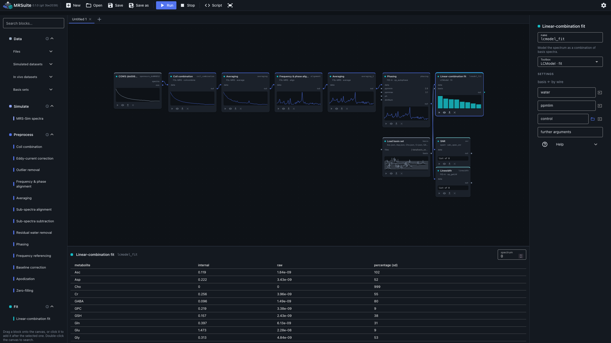
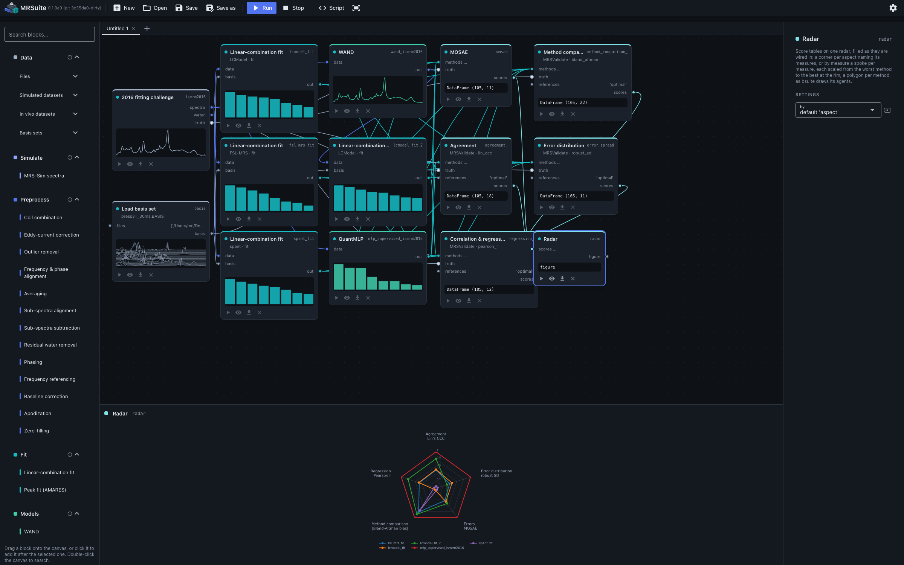
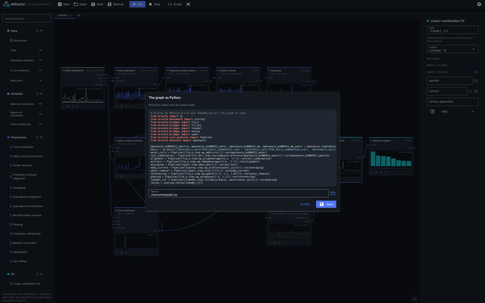

# GUI

```bash
mrsuite-gui
```

Wire blocks on a canvas. One block per step, each offering every toolbox that does it, and
every function of every toolbox besides. Each block shows what it made, exports it, and reads
out its NIfTI-MRS header and history. The graph is written out as the Python that makes it
again. The GUI opens in a window of its own where it can (pywebview), else in the browser
(`--browser`). `mrsuite-gui --install` makes it an app with MRSuite's icon; see
[Install](install.md#the-gui-as-an-app).



*In vivo processing: coils, alignment, outliers, averaging, eddy currents, water, referencing
and phasing by four toolboxes, then LCModel with the water reference.*



*A benchmark: the 2016 fitting challenge into four fitters, scored on five aspects against the
truth and drawn on a radar.*



*The same processing as the Python it writes.*

## The blocks

The palette's tabs, as the GUI describes them (`mrsuite/gui/blocks.py`, `GROUPS`):

| Tab | What it holds |
|---|---|
| Data | Load spectra and ground truth from files and folders, named as you like, or the challenges; and basis sets, in any format. Every block exports what it made; Convert basis set writes its files itself. |
| Simulate | Basis sets and spectra with known contents, by every simulator: FID-A's, spant's, FSL-MRS's and Vespa's density-matrix simulations, Spinach's in the Liouville space, FSL-MRS's and spant's synthetic spectra, MRS-Sim, and MRSandbox's virtual scanner on its virtual brain; the pulse sequences they play, from MRSandbox's library or any Pulseq file, and the toolboxes' RF pulse tools under All functions. |
| Augment | Vary the spectra, physically consistently, with Augmentrum: the signal (noise, line broadening, baselines, phase and frequency, amplitude), artifacts (residual water, macromolecules, eddy currents, spurious echoes, contaminant peaks), and what the scan sampled (coils, transients, k-space); a water reference wired in is varied alike. |
| Preprocess | Prepare the spectra for analysis: correct imperfections, reduce dimensionality (Near et al., NMR Biomed 2021, Tables 2-4). |
| Fit | Spectral analysis: model the spectrum to estimate its signals, in arbitrary units or, with a water reference, as the toolbox quantifies them (Near 2021; Kreis et al., NMR Biomed 2021, section 4.2). |
| Models | Trained networks from MRSuite's model zoo on the Hugging Face Hub: a checkpoint each, loaded by name. WAND is a processing step and gives spectra; the MLPs fit. |
| Evaluate | Judge the spectra and the fits: spectral quality (SNR, linewidth), and fits against the ground truth with every analysis of MRSValidate that compares the two (Kreis et al., NMR Biomed 2021, section 4.3), its plots, and a radar of the scores; and fits against each other, without a truth, in SpecVis's raincloud, correlation and Bland-Altman plots and its statistics. |
| MRSI | Spectroscopic imaging on a spatial NIfTI-MRS: spant's k-space, mask and voxel tools and FSL-MRS's alignment, phasing and lipid removal across the voxels; then the voxels apart, so every step and fitter takes them, and the fits back on the grid as metabolite maps. FID-A's CSI functions are under All functions (they need the MATLAB runtime). |
| Other | Further operations the toolboxes offer: modelling peaks, cropping, conjugating, shifting, matching linewidths, resampling, adding and selecting. |
| All functions | Every function of every toolbox. |

The first time a block uses a toolbox, the GUI asks it for the function's arguments in the
background (an Octave or R toolbox can take seconds); the block's inputs appear once it has
answered, and the page stays live meanwhile.
